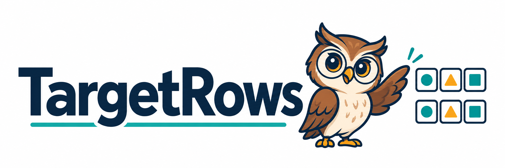

<p align="center">
  
</p>

<h3 align="center">Understanding Target Probability Reuse<br>in Speculative Decoding</h3>

<div align="center">

[](https://www.python.org/) [](https://numpy.org/) [](https://github.com/js-lee-AI/TargetRows/actions/workflows/ci.yml)

<b><a href="#overview">Overview</a> · <a href="#quick-start">Quick start</a> · <a href="#usage">Usage</a> · <a href="#api">API</a> · <a href="docs/algorithms.md">Method details</a> · <a href="#faq">FAQ</a> · <a href="#citation">Citation</a></b>

</div>

<p align="center">
  Jungseob Lee · Giyoon Jang · Chailin Nam · Jiwoo Kum · Sihyeon Lee<br>
  Kyojun Choo · Jihun Song · Eunseo Song · Chanjun Park
</p>

---

## Overview

Speculative decoding verifies a tree of draft tokens with a target model. The same pass also computes next-token probability distributions at the scored prefixes. **When can those distributions be reused, and how can a target distribution improve the next tree's allocation?**

TargetRows provides the core algorithms for studying both questions:

| Component | What it does |
| --- | --- |
| **Root selection** | Reranks a candidate pool by replacing the first draft factor with the exact target probability. |
| **Root-draw selection** | Draws the first token from the target before allocating the tree beneath it. |
| **Exact-context reuse** | Looks up a retained probability row using the full committed token context. |
| **Verification and acceptance** | Follows target draws through a tree and computes expected accepted-token counts. |

The library runs on a CPU with NumPy. This release contains the core implementation, a synthetic example, and tests; model execution and KV-cache management belong to the caller.

## Quick start

```bash
git clone https://github.com/js-lee-AI/TargetRows.git
cd TargetRows
python -m pip install .
python examples/quickstart.py
```

Python 3.10 or newer is required. The example needs no GPU, checkpoint, or dataset. CI runs the example and the tests on Python 3.10 and 3.12.

<details>
<summary>Example output — synthetic three-token vocabulary</summary>

```text
Synthetic example: expected accepted tokens (continuation excluded)
Draft        0.428  ((0,), (0, 0), (0, 1), (0, 0, 0))
Root         1.824  ((1,), (1, 0), (1, 0, 0), (0,))
Oracle       1.824  ((1,), (1, 0), (1, 0, 0), (0,))
Root-draw    2.257
Preselected  1.228
```

These are illustrative values from the example, not the paper's benchmark results. The budget is four non-root nodes. Root-draw and preselected-tree pruning average over the target first draw and count it as accepted; all counts exclude the additional continuation token.

</details>

## Usage

### Select a tree with the target root row

Represent each candidate as a tuple of token IDs relative to the current context. The pool contains every candidate's ancestors, with parents listed before children. Supply cumulative draft log probabilities, rather than individual edge scores.

```python
import numpy as np
from target_rows import CandidatePool, select_root, select_root_draw

pool = CandidatePool(
    paths=((0,), (1,), (0, 0), (1, 0)),
    draft_log_scores=tuple(np.log([0.7, 0.3, 0.42, 0.24])),
)
root_row = np.array([0.2, 0.8])

# Replace the first draft factor with the target probability.
tree = select_root(pool, root_row, budget=3)
print(tree)  # ((1,), (1, 0), (0,))

# Or sample first, then allocate the tree beneath the sampled token.
rng = np.random.default_rng(7)
first = int(rng.choice(len(root_row), p=root_row))
adaptive_tree = select_root_draw(pool, first, budget=3)
```

For root-draw selection, pass the same `first` token to `verify_tree(..., first_token=first)` after obtaining the target rows for the selected tree. This consumes the draw once. The complete selection-and-verification example is in [`examples/quickstart.py`](examples/quickstart.py).

### Reuse a row at its exact context

```python
from target_rows import ExactRowCache

cache = ExactRowCache()
cache.put((10, 20, 30), [0.2, 0.8])

assert cache.get((10, 20, 30)) is not None  # Same full context.
assert cache.get((11, 20, 30)) is None      # Same last token, different context.
```

Each cache belongs to one fixed target computation. Clear it when model weights, tokenizer, attention or position semantics, numerical execution semantics, temperature, or probability transformations change. The caller is responsible for preserving those conditions.

## API

| Function | Purpose |
| --- | --- |
| `select_draft` | Keep candidates in the original draft order. |
| `select_root` | Replace the first path factor with the target probability. |
| `select_root_draw` | Allocate descendants after the first target draw. |
| `select_preselected` | Prune a preselected draft tree beneath that same draw. |
| `select_oracle` | Rank by target path probabilities when rows throughout the pool are available. |
| `verify_tree` | Accept a target path, emit one continuation, and report address coverage. |
| `expected_acceptance` | Evaluate expected accepted draft tokens for a fixed tree. |
| `expected_root_draw_acceptance` | Average acceptance over the target first draw. |
| `distribution` | Convert logits to a softmax distribution, or an argmax point mass at temperature zero. |
| `ExactRowCache` | Store and retrieve rows by the full token context. |

[Method details](docs/algorithms.md) cover the equations, tie handling, verification inputs, stopping policies, and acceptance conventions.

## Checks

```bash
python -m unittest discover -s tests -v
```

The 21 CPU tests cover selection, exact output distributions on small trees, acceptance and coverage identities, zero-probability branches, and cache isolation.

## FAQ

**Does this repository run the paper's full GPU experiments?**

It provides the core algorithms and a CPU example. Benchmark harnesses, datasets, generated outputs, model weights, and GPU serving integrations are outside this release.

**What happens if the first target draw is absent from the pool?**

Root-draw selection keeps that token alone. The caller must obtain its target row during verification.

**Does the acceptance count include the continuation token?**

No. Root-draw selection counts its first target draw as accepted, but excludes the continuation token, just like fixed-tree acceptance.

**Can I reuse a row because the final token matches?**

The cache requires the complete token context. Different prefixes can end in the same token while having different next-token distributions.

## Repository layout

```text
target_rows/core.py       selection, verification, acceptance, and exact-row cache
examples/quickstart.py    complete synthetic CPU example
tests/test_core.py        selection and verification checks
docs/algorithms.md       equations and integration assumptions
```

## Citation

```bibtex
@misc{lee2026targetrows,
  title = {Understanding Target Probability Reuse in Speculative Decoding},
  author = {Lee, Jungseob and Jang, Giyoon and Nam, Chailin and Kum, Jiwoo
            and Lee, Sihyeon and Choo, Kyojun and Song, Jihun and Song, Eunseo
            and Park, Chanjun},
  year = {2026},
  url = {https://github.com/js-lee-AI/TargetRows}
}
```

The preselected-tree comparison implements the PEARL-style pruning rule discussed in the paper, using a supplied candidate pool. See [PEARL](https://arxiv.org/abs/2408.11850) for its full decoding and GPU scheduling system.
