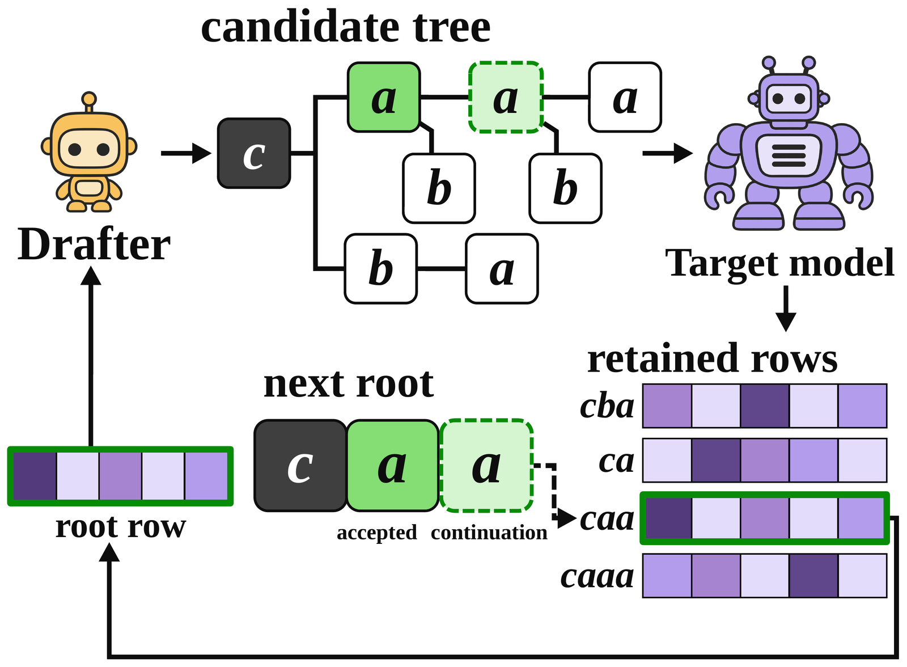
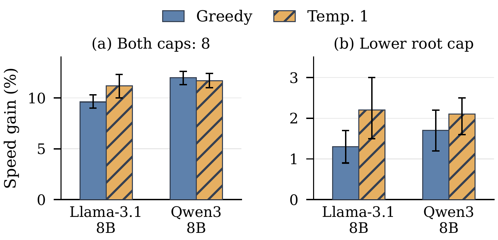

<p align="center">
  
</p>

<div align="center">

[](LICENSE)
[](https://www.python.org/)
[](https://github.com/js-lee-AI/TargetRows/actions/workflows/ci.yml)
[](https://github.com/js-lee-AI/TargetRows/stargazers)

<b><a href="#quick-start">Quick start</a> · <a href="#usage">Usage</a> · <a href="#command-line">CLI</a> · <a href="#gpu-examples">GPU examples</a> · <a href="#results">Results</a> · <a href="#faq">FAQ</a> · <a href="#citation">Citation</a></b>

</div>

---

## News

- **[2026-10-21]** Code released, with the tree-selection and verification algorithms and a GPU decoder for public Qwen3 and Llama target and drafter pairs.

## Overview

Speculative decoding verifies a tree of draft tokens with a target model in one pass. That pass also computes next-token distributions, which we call rows, at the prefixes it scores. The drafter, however, has to choose the next tree before the target's probabilities for it are known.

TargetRows rests on three ideas.

* **Exact reuse needs the full context.** A retained row gives exact next-token probabilities for the next round only when it was computed at that round's complete context, its address. Two contexts that end in the same token can have different distributions, so rows are stored and looked up by the full token context.
* **Root selection.** Ranking candidate paths with the target's probability for their first token and the drafter's probabilities for the later tokens raises expected acceptance over draft ranking, most of all with small trees.
* **Root-draw selection.** Drawing the first token from the target's root row before allocating the tree beneath it gives higher expected acceptance than pruning a preselected tree to that token's branch, even at equal mean tree size.

This repository is the selection rules, exact-context row reuse, tree verification and the expected-acceptance accounting as a small NumPy library, plus a GPU decoder that runs the rules with public target and drafter pairs.

## What it does in one picture

<p align="center">
  
</p>

<p align="center"><em>Address matching across decoding rounds (paper Figure 1). Verification from context c accepts a and emits another a as its continuation, so the next round starts at caa. The retained row at caa is exact for that round; the row at ca has a different address.</em></p>

## Quick start

```bash
pip install "git+https://github.com/js-lee-AI/TargetRows.git"
```

```python
import numpy as np
from target_rows import CandidatePool, select_draft, select_root, select_root_draw

# four candidate paths after the current context, with cumulative draft log probabilities
pool = CandidatePool(
    paths=((0,), (1,), (0, 0), (1, 0)),
    draft_log_scores=tuple(np.log([0.7, 0.3, 0.42, 0.24])),
)
root_row = np.array([0.2, 0.8])  # the target's next-token row at the current context

print(select_draft(pool, budget=3))           # ((0,), (0, 0), (1,))
print(select_root(pool, root_row, budget=3))  # ((1,), (1, 0), (0,))
first = 1                                     # a first token drawn from root_row
print(select_root_draw(pool, first, budget=3))  # ((1,), (1, 0))
```

This runs on a CPU and downloads nothing. The drafter prefers token 0, the target prefers token 1, and root selection moves the tree under the target's choice. [`examples/quickstart.py`](examples/quickstart.py) adds verification and expected acceptance for every rule, and CI runs it on every push.

To decode with real models on a GPU, install a CUDA build of PyTorch and the `gpu` extra:

```bash
pip install torch==2.10.0 --index-url https://download.pytorch.org/whl/cu128
pip install "target-rows[gpu] @ git+https://github.com/js-lee-AI/TargetRows.git"

CUDA_VISIBLE_DEVICES=0 target-rows generate --preset qwen3-4b --policy root-draw \
  --prompt "Explain speculative decoding in two sentences." \
  --max-new-tokens 128 --output results/generation.json
```

| install | adds | enough for |
|---|---|---|
| `pip install "git+https://github.com/js-lee-AI/TargetRows.git"` | numpy | the selection rules, verification, expected acceptance, the row cache and the CPU example |
| `pip install "target-rows[gpu] @ git+https://github.com/js-lee-AI/TargetRows.git"` | torch, transformers 4.53.1, accelerate | the GPU decoder and the `target-rows` command |
| `git clone` and then `pip install -e ".[gpu]"` | | `tests/` and local changes |

GPU checks ran with Python 3.11, PyTorch 2.10.0 with CUDA 12.8 and Transformers 4.53.1 on A100 80 GB GPUs, and the paper's two-GPU timings used RTX A6000 GPUs. The [GPU guide](docs/gpu.md) covers other CUDA wheels, model access, memory and the measurement conventions.

## Usage

### Select a tree with the target root row

Represent each candidate as a tuple of token IDs relative to the current context. The pool contains every candidate's ancestors, with parents listed before children, and takes cumulative draft log probabilities rather than individual edge scores. The budget counts non-root nodes.

For root-draw selection, sample the first token from the root row and pass the same token to `verify_tree(..., first_token=first)` once the target rows of the selected tree are available. This consumes the draw once:

```python
rng = np.random.default_rng(7)
first = int(rng.choice(len(root_row), p=root_row))
tree = select_root_draw(pool, first, budget=3)
```

### Reuse a row at its exact context

```python
from target_rows import ExactRowCache

cache = ExactRowCache()
cache.put((10, 20, 30), [0.2, 0.8])

assert cache.get((10, 20, 30)) is not None  # the same full context
assert cache.get((11, 20, 30)) is None      # the same last token, a different context
```

Each cache belongs to one fixed target computation. Clear it when the weights, the tokenizer, the attention or position semantics, the numerical execution, the temperature or any probability transformation changes; the caller is responsible for keeping those fixed.

### API at a glance

| call | what it does | needs |
|---|---|---|
| `select_draft(pool, budget)` | keep candidates in the drafter's order | base install |
| `select_root(pool, root_row, budget)` | replace the first path factor with the target probability | base install |
| `select_root_draw(pool, first, budget)` | allocate descendants after the first target draw | base install |
| `select_preselected(pool, first, budget)` | prune a preselected draft tree beneath that same draw | base install |
| `select_oracle(pool, rows, budget)` | rank by target path probabilities when rows throughout the pool are available | base install |
| `verify_tree(tree, rows, ...)` | accept a target path, emit one continuation and report address coverage | base install |
| `expected_acceptance`, `expected_root_draw_acceptance` | expected accepted draft tokens of a fixed tree, or averaged over the first draw | base install |
| `distribution(logits, temperature)` | softmax, or a point mass at the argmax at temperature zero | base install |
| `ExactRowCache` | store and retrieve rows by the full token context | base install |
| `target_rows.gpu`, `target_rows.torch_backend` | the GPU decoder, static KV cache and CUDA graphs | `[gpu]` |

[Method details](docs/algorithms.md) cover the equations, tie handling, verification inputs, stopping policies and acceptance conventions.

## Command line

Installing the `gpu` extra adds a `target-rows` command, and `python -m target_rows.gpu` runs the same thing.

```bash
target-rows --help
target-rows generate --preset qwen3-4b --policy root-draw --prompt "..."   # one decoder, one GPU
target-rows compare --preset qwen3-8b --target-device cuda:0 --draft-device cuda:1 \
  --prompts-file prompts.jsonl --budget 59 --output results/compare.json    # all five decoders
```

`generate` runs one decoder (`ar`, `draft`, `root`, `root-draw` or `preselected`). `compare` runs all five on the same prompts and saves the generated text and token IDs, accepted-token counts, verified tree sizes, timings, hardware and configuration. At temperature zero every record also checks the output against AR.

## GPU examples

| example | public target / drafter | deployment |
|---|---|---|
| generate | Qwen3-4B / Qwen3-0.6B | one GPU, drafting and verification in turn |
| compare decoders | Qwen3-8B / Qwen3-0.6B | two GPUs, drafting overlaps the target's root pass |
| second model family | Llama-3.1-8B-Instruct / Llama-3.2-1B-Instruct | two GPUs, upstream Llama access required |

The first example is the quick start above. To compare the five decoders on one prompt:

```bash
CUDA_VISIBLE_DEVICES=0,1 target-rows compare \
  --preset qwen3-8b --target-device cuda:0 --draft-device cuda:1 \
  --prompt "Write a Python function that checks whether a string is a palindrome." \
  --budget 59 --temperature 0 --max-new-tokens 256 \
  --output results/qwen8b-comparison.json
```

For the Llama pair, after obtaining access to both models:

```bash
CUDA_VISIBLE_DEVICES=0,1 target-rows compare \
  --preset llama3-8b --target-device cuda:0 --draft-device cuda:1 \
  --prompt "Explain speculative decoding in two sentences." \
  --budget 59 --max-new-tokens 128 --output results/llama8b-comparison.json
```

Use `--temperature 1` for sampling, `--budget 8` for the small tree of the paper, or `--prompts-file prompts.jsonl` for your own prompt set. The Qwen3-8B and Llama pairs are the paper's standalone-drafter pairs and Qwen3-4B is a smaller starting point. The presets pin upstream revisions, and no trained TargetRows checkpoint is needed.

## Results

Root selection and root-draw selection raise expected acceptance on all six targets, and with standalone drafters root-draw selection also decodes faster than the PEARL-style decoder.

<p align="center">
  
</p>

<p align="center"><em>Root-draw selection's decoding-speed gain over the PEARL-style decoder on two RTX A6000 GPUs (paper Figure 4). Left: both caps are 8. Right: the PEARL-style cap is 59 and root-draw caps are 40 to 43.</em></p>

### Expected accepted draft tokens (paper Table 2)

Greedy decoding on EAGLE-3 dynamic trees, at shared contexts. Draft keeps the drafter's ranking, Root replaces the first draft factor with the target probability, and Oracle ranks by exact target path probabilities. B is the number of non-root nodes.

| target | B=8 Draft | Root | Oracle | B=59 Draft | Root | Oracle |
|---|---|---|---|---|---|---|
| Llama-3.1-8B | 3.186 | 3.568 | 4.899 | 4.509 | 4.676 | 4.899 |
| Qwen3-4B | 1.664 | 2.002 | 2.720 | 2.340 | 2.516 | 2.720 |
| Qwen3-8B | 1.556 | 1.919 | 2.564 | 2.221 | 2.399 | 2.564 |
| Qwen2.5-7B | 2.359 | 2.710 | 3.636 | 3.293 | 3.450 | 3.636 |
| Qwen2.5-14B | 2.435 | 2.790 | 3.846 | 3.486 | 3.645 | 3.846 |
| Qwen2.5-32B | 2.464 | 2.812 | 3.843 | 3.489 | 3.646 | 3.843 |

The paper's Table 2 also gives sampling at temperature 1 and root-draw selection's gain over the PEARL-style decoder, under the same cap and at equal mean tree size.

### Online decoding at B=59 (paper Table 3)

Root-draw selection's gain in accepted draft tokens over the PEARL-style decoder with a separate root pass, in percent, with 95% intervals. Nodes gives mean non-root counts as root draw / PEARL-style.

| target | greedy gain | nodes | temperature 1 gain | nodes |
|---|---|---|---|---|
| Llama-3.1-8B | 3.3 [2.6, 4.1] | 53 / 39 | 4.1 [1.7, 6.8] | 48 / 34 |
| Qwen3-4B | 6.7 [6.2, 7.3] | 49 / 33 | 7.1 [6.4, 7.9] | 48 / 32 |
| Qwen3-8B | 7.3 [6.6, 8.0] | 44 / 28 | 7.3 [6.3, 8.3] | 43 / 27 |
| Qwen2.5-7B | 4.5 [3.6, 5.5] | 49 / 35 | 5.7 [4.1, 7.4] | 46 / 32 |
| Qwen2.5-14B | 3.8 [3.1, 4.4] | 49 / 36 | 4.5 [3.0, 5.9] | 47 / 32 |
| Qwen2.5-32B | 3.7 [3.0, 4.3] | 50 / 36 | 4.7 [3.4, 6.1] | 47 / 33 |

Both tables come from EAGLE-3 drafters on six targets, seven task types and two temperatures, and Table 2 scores every rule on the same recorded target rows. The recordings, the EAGLE-3 runs and the learned-reranker training are not part of this release. `target-rows compare` runs the same five decoders with standalone drafters on your own prompts and hardware.

## Repository layout

```
target_rows/core.py           selection, verification, expected acceptance and the exact-row cache
target_rows/decoding.py       draft pool, tree verification and generation
target_rows/drafter.py        same-GPU drafting and the second-GPU worker
target_rows/torch_backend.py  Llama and Qwen3 forward, static KV cache, CUDA graphs
target_rows/gpu.py            the generate and compare commands and the pinned model presets
examples/quickstart.py        the complete CPU example
docs/algorithms.md            equations and integration assumptions
docs/gpu.md                   installation, three GPU recipes and the measurement guide
tests/                        CPU tests that CI runs, with tiny random models for the backend
```

## FAQ

<details>
<summary><b>Do I need a GPU?</b></summary>

Only for the decoder. The selection rules, verification, expected acceptance and the row cache run on a CPU with the base install. The GPU decoder needs an NVIDIA GPU, a CUDA build of PyTorch and the `gpu` extra.

</details>

<details>
<summary><b>Do I need new model weights?</b></summary>

No. Root selection and root-draw selection use the public target and drafter unchanged. Models download from their original providers, subject to their access conditions; this repository distributes code, not checkpoints or benchmark data.

</details>

<details>
<summary><b>What happens if the first target draw is absent from the pool?</b></summary>

Root-draw selection keeps that token alone, and the caller must obtain its target row during verification.

</details>

<details>
<summary><b>Does the acceptance count include the continuation token?</b></summary>

No. Root-draw selection counts its first target draw as accepted but excludes the continuation token, as fixed-tree acceptance does.

</details>

<details>
<summary><b>Can I reuse a row because the final token matches?</b></summary>

No. The cache requires the complete token context, since different prefixes can end in the same token and still have different next-token distributions.

</details>

<details>
<summary><b>How is this different from PEARL?</b></summary>

The preselected-tree comparison implements PEARL's pruning rule on a supplied candidate pool: it selects a draft tree first and keeps the branch beneath the target's first draw. Root-draw selection instead allocates the whole budget after the draw. The full PEARL decoding and GPU scheduling system is described in its [paper](https://arxiv.org/abs/2408.11850).

</details>

## Citation

Citation details and BibTeX will be added when the paper's preprint is publicly available.

## License

Code is MIT, see [LICENSE](LICENSE).

## Acknowledgments

The paper's trees are the dynamic trees of [EAGLE-3](https://github.com/SafeAILab/EAGLE), the preselected-tree comparison follows [PEARL](https://arxiv.org/abs/2408.11850), and the GPU decoder loads its models through [Hugging Face Transformers](https://github.com/huggingface/transformers).
